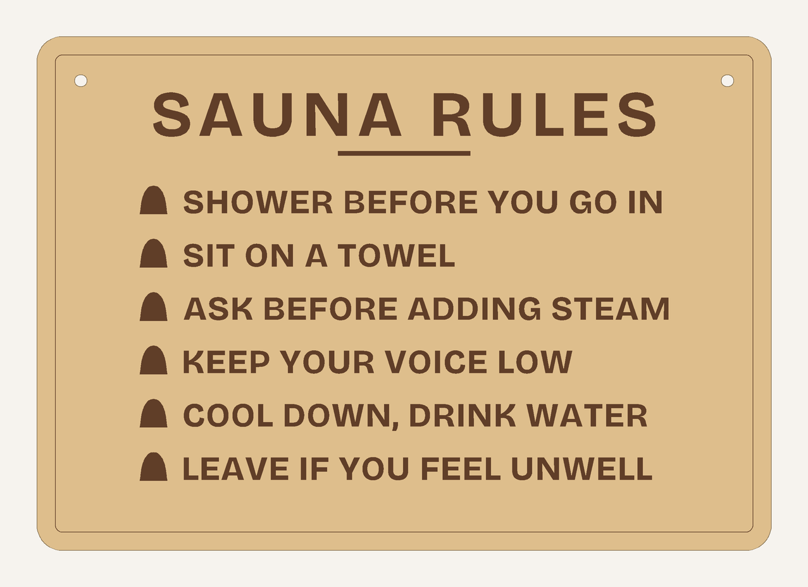
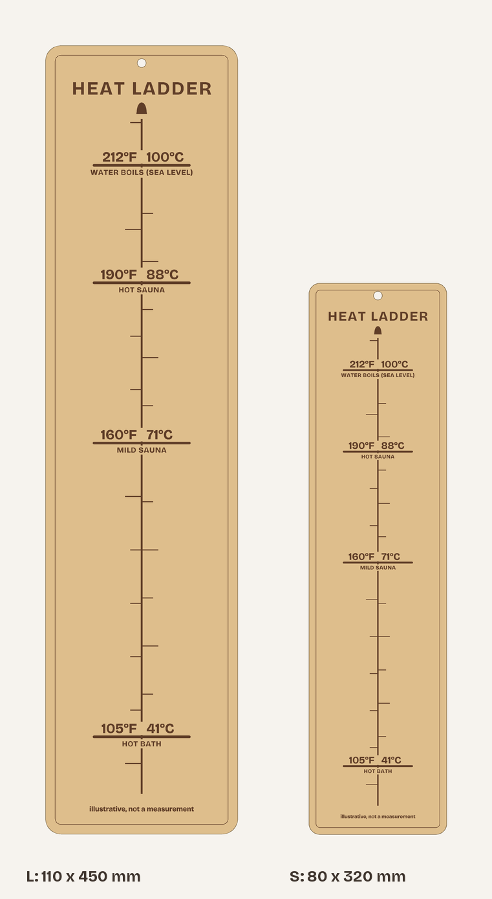
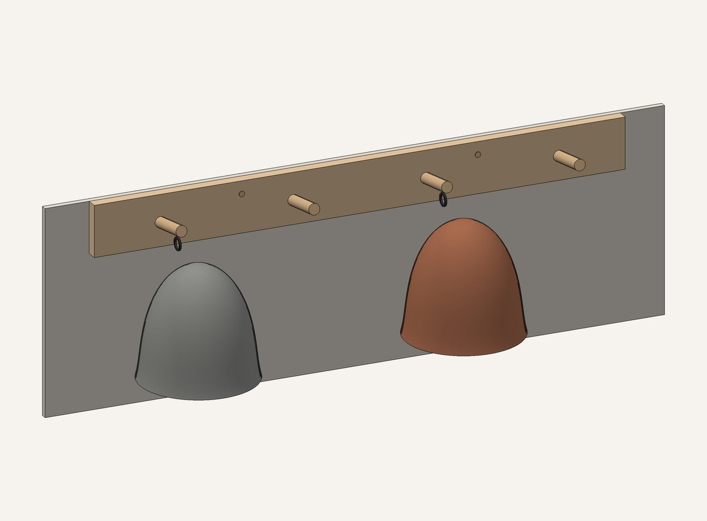
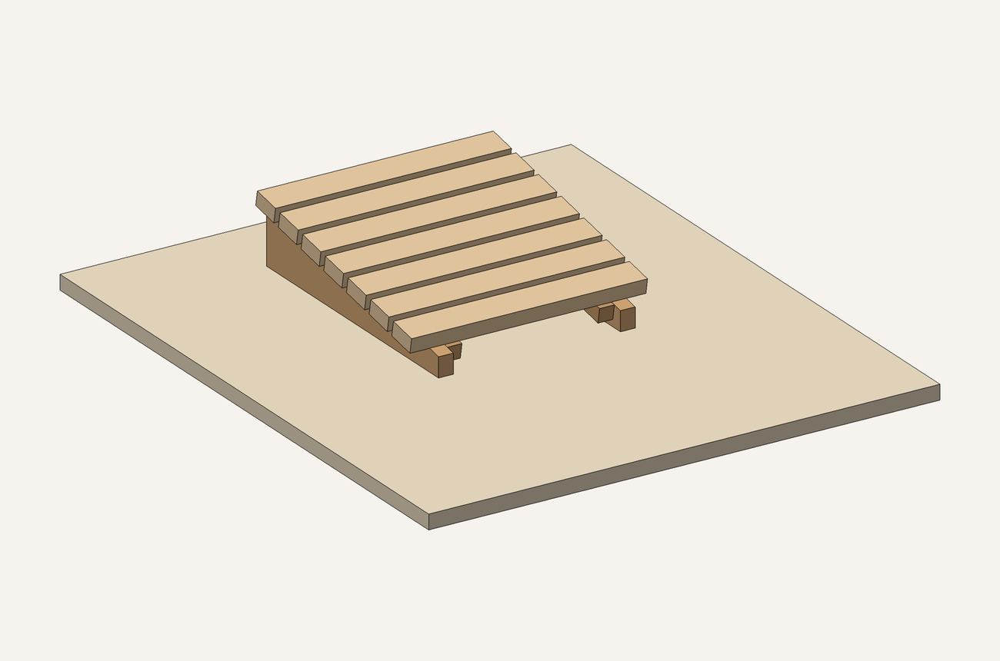
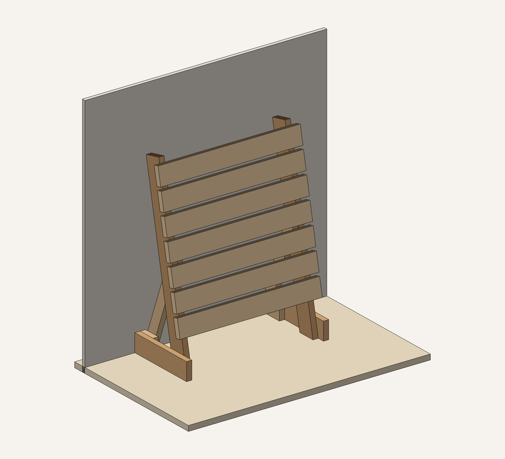
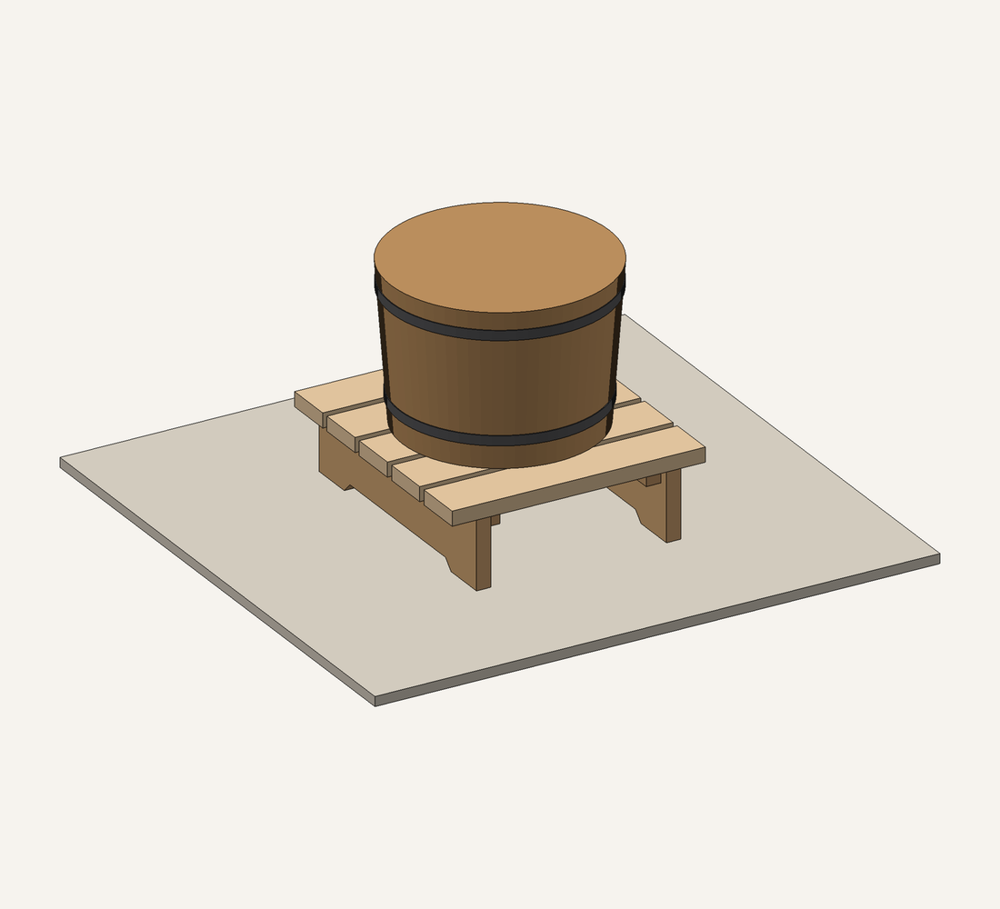

# Sauna laser-cut files

Free, parametric laser-cutting files for the sauna, from [DIVELUX](https://diveluxsaunahat.com), makers of handmade wool felt sauna hats.

| | Project | Material |
|---|---|---|
|  | **[SAUNA door sign](sauna-door-sign/)**: cut outline, scored border, engraved letters. Three sizes: 200 × 75, 300 × 112.5 and 400 × 150 mm. Any word you like with the script. | 3–6 mm plywood or solid wood |
|  | **[Plywood sauna hat drying stand](sauna-hat-stand-plywood/)**: two arch ribs that cross slot-in-slot plus a base ring. 186 × 186 × 201 mm assembled. The same outline as the 3D-printed stand; the slots follow your sheet thickness. | 3 or 4 mm plywood |
|  | **[Sauna rules board](sauna-rules-board/)**: SAUNA RULES and six short rules with bell-hat marks; cut outline, scored border, engraved text. Two sizes: 300 × 210 and 450 × 315 mm. Your own rules from a text file. | 3–6 mm plywood or solid wood |
|  | **[Heat ladder wall plank](sauna-heat-ladder-plank/)**: a °F / °C scale with marks at 212, 190, 160 and 105 °F (100, 88, 71, 41 °C) and a footnote: illustrative, not a measurement. 80 × 320 and 110 × 450 mm. | 3–6 mm light wood |

Each folder has `svg/`, `dxf/`, preview pictures in `img/`, a `LISTING.md` with cutting notes, and the Python source. The shared helper `dvx_laser.py` sits in this folder.

## Woodworking plans

Shop projects for the sauna, each as a two-page PDF (Letter landscape) with views, every dimension in inches and millimeters, a cut list, hardware, assembly steps and a safety box. Three of them come with full-size SVG/DXF templates.

| | Plan | Lumber |
|---|---|---|
|  | **[Peg rail for sauna hats](sauna-hat-peg-rail/)**: 36 in rail, four dowel pegs tilted up 10°, screws hidden under plugs. Drilling template (full length and a half for small lasers) plus a 10° drilling wedge. | 1x4, 3/4 in dowel |
|  | **[Bench headrest](sauna-bench-headrest/)**: 14 × 12 in, wedge sides rising from 1 to 3-1/2 in, seven slats, screws from below through cleats. Full-size side template. | 1x4, 1x2, 3/4 in strip |
|  | **[Bench backrest](sauna-bench-backrest/)**: freestanding, 20 in wide, leans back 12°, two braced triangle frames that stand with their back to the wall, seven slats. | 1x3, 1x2 |
|  | **[Bucket stand](sauna-bucket-stand/)**: 13 × 14 in, 4-1/4 in high, slatted, on four feet. Full-size runner template. | 1x4, 1x3, 3/4 in strip |

The plans are built from Python (`dvx_plans.py`: parts as boxes, projected views, dimension lines, the cut list) and printed to PDF with Playwright: `./build_plans.sh`. They are hobby plans, not engineered drawings: build at your own risk, and check that nothing can burn or pinch.

## File conventions

- Units are millimeters, scale 1:1. Every drawing has a 5 mm margin around the parts.
- Layers are set apart by color, the way laser software expects:

| Layer | Color | Meaning |
|---|---|---|
| CUT | red (255, 0, 0), hairline stroke | cut through |
| SCORE | blue (0, 0, 255), hairline stroke | light vector line |
| ENGRAVE | black fill | raster engrave |

- In the SVG files the layers are named groups (they open as layers in Inkscape). In the DXF files they are layers named CUT, SCORE and ENGRAVE, and every shape is a closed polyline, so the files open in LightBurn, LaserGRBL, Inkscape, Fusion and most CAD programs.
- Lettering is converted to outlines. No font is needed to open the files.

## Changing the designs

Install the tools once: `pip install manifold3d fonttools numpy pillow`. Then edit the block of parameters at the top of a source file and run it, for example:

```
python3 sauna-door-sign/door_sign.py BANYA        # the sign with your own word, all three sizes
python3 sauna-hat-stand-plywood/stand_laser.py 3.4 # the stand for sheet that measures 3.4 mm
python3 sauna-rules-board/rules_board.py myrules.txt  # title on the first line, then up to 8 rules
```

Text needs a bold TrueType font. Set the `DVX_FONT` environment variable to a .ttf file, or let the script pick a system font.

## Before you cut

- Test power and speed on a scrap of the same sheet.
- Run engraving first, then scoring, then cutting.
- Measure your sheet. Plywood sold as 3 mm is often 2.7 to 3.2 mm, and slot joints only work when the drawing matches the sheet.
- Plywood is for the changing room and the outside of the door. Inside a hot room use solid, unfinished wood.

## About the hat

A wool felt sauna hat is worn dry and air-dried after each visit, which is what the drying stand is for. The 3D-printable version of the stand and more sauna accessories are in the companion 3D-print set. More free sauna tools: https://diveluxsaunahat.com/pages/sauna-tools

## License

[CC BY 4.0](https://creativecommons.org/licenses/by/4.0/). Credit DIVELUX with a link to https://diveluxsaunahat.com.
